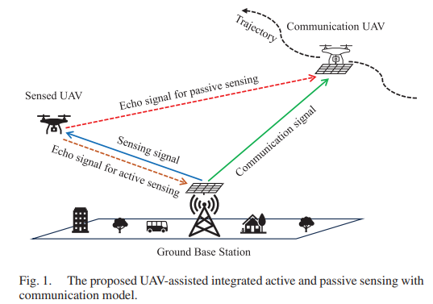
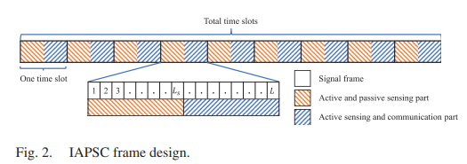
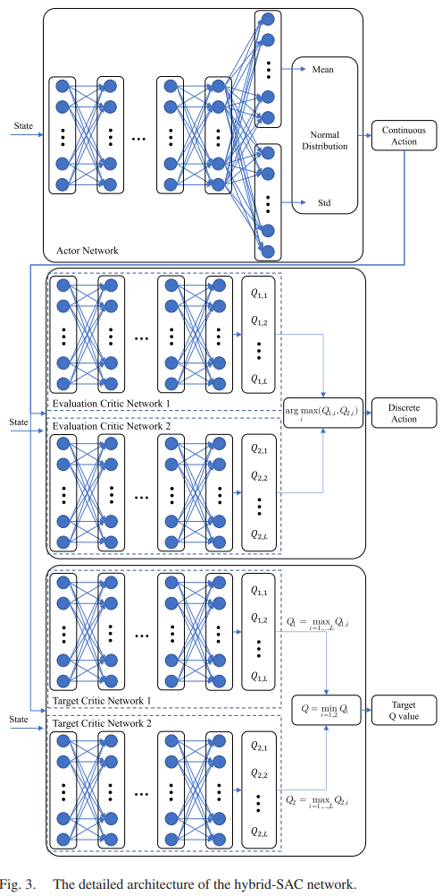
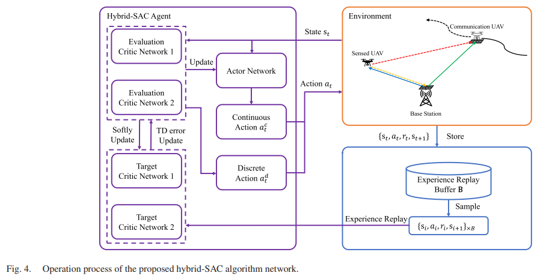
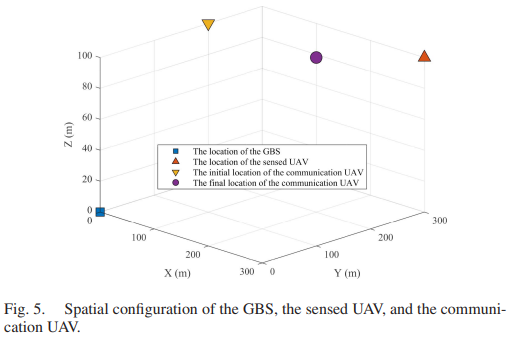
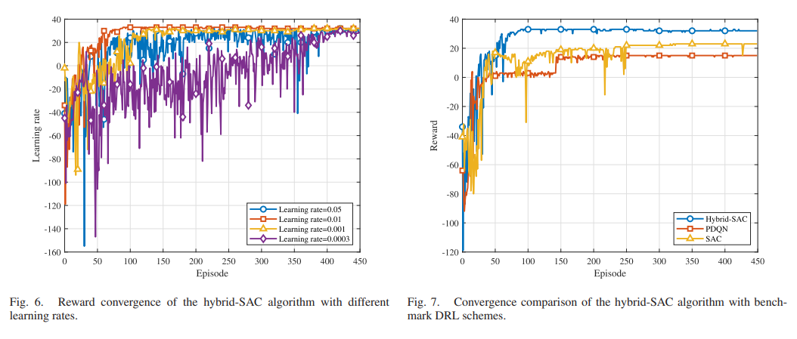
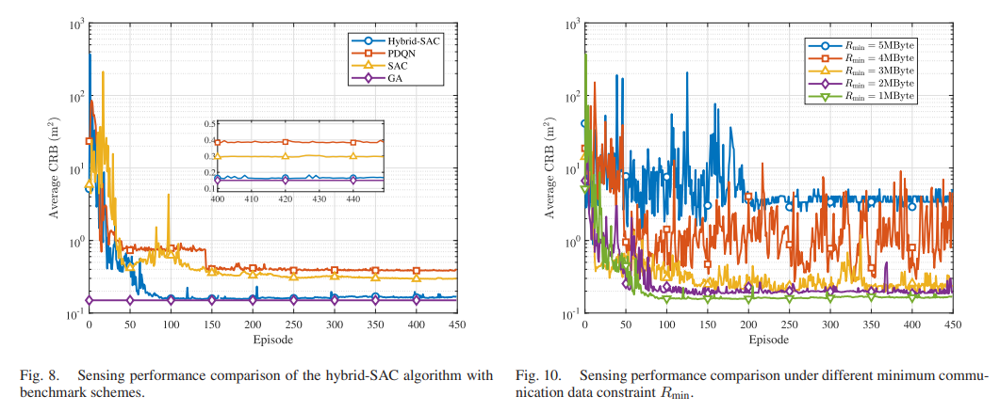
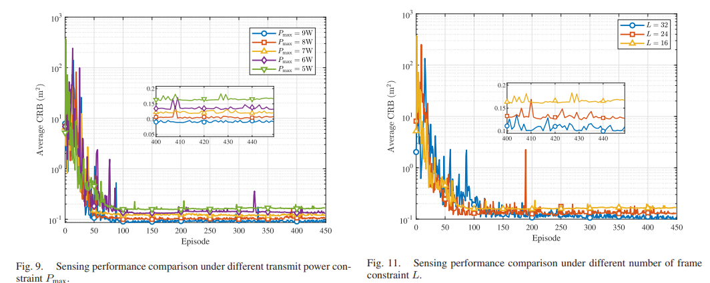
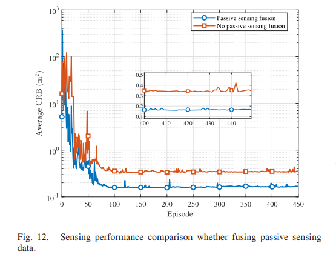

# UAV+ISAC: Drone-aided Active+Passive Perception: Hybrid SAC Algorithms for "Win-Win" Communications and Perception[with Python code]

UAV-assisted active+passive perception: hybrid SAC algorithm achieves "win-win" in communication and perception. A logistics drone flying on a planned route can, while transmitting a small number of flight instructions, act as an "airborne ear", helping ground base stations to precisely locate unknown unauthorized flights—this is the new paradigm of integrated sensory and communication (ISAC). Abstract: With the rapid development of low-altitude economy, a large number of drones will participate in logistics and delivery tasks, as well as urban inspections. These drones usually fly according to pre-planned routes, only needing to transmit a small amount of data about flight instructions (low communication load) between them and ground base stations (GBS). So, can these "light-load" drones be used for more valuable tasks during their idle time? This paper gives a positive answer: let communication drones take up passive perception receiver roles during their idle periods, receiving echoes from unknown targets, and work in conjunction with the ground base station's own active perception, thereby significantly improving the accuracy of detecting unauthorized flights.
Specifically, this paper proposes an integrated framework for UAV-assisted active-passive perception and communication (IAPSC). Here, ground base stations send ISAC signals, and communication drones fly along the pre-determined trajectory, receiving echoes from unknown drones (passive perception) in some signal frames, and then retransmitting the data back to the base station for fusion. The authors derive the CRB after merging active and passive measurements, and use it as the optimization target. Considering the problem involves discrete frame allocation and continuous beamforming/power allocation, it is a mixed action space optimization problem, this paper proposes a hybrid-SAC algorithm—using a double-layer critic network to handle discrete action selection within the SAC framework, and actor network to output continuous actions.
Simulation results show that the hybrid-SAC algorithm improves perception performance by 43% compared to the original SAC algorithm, converges faster than benchmarks like PDQN, and its positioning accuracy approaches that of traditional genetic algorithms but with significantly reduced computational complexity.
1. Introduction: Why is the integration of drones and integrated sensors a perfect match?
1.1 The low-altitude economy has spurred new demands. Drones are used for delivery, aerial inspections, agricultural monitoring, etc. The low-altitude economy is becoming a new growth pole. However, with numerous drones flying in the low altitude, it inevitably brings regulatory challenges: what to do about unauthorized "black flights" that enter restricted areas? Traditional radar systems are costly and their visual solutions are limited by weather conditions. The use of existing cellular networks for perception (i.e., integrated sensor and communication system, ISAC) is recognized as the most promising solution.
1.2 Drones as ISAC: Two approaches currently, there are mainly two ways for drones to integrate with ISAC:
1.  Drones acting as ISAC platforms themselves: Drones serve both as communication base stations and radars. This approach is flexible but is limited by battery life and computing power, making it difficult to achieve high precision perception.
2. Drones working in collaboration with ground base stations: Ground base stations provide strong computing power and stable power supply, while drones offer flexible coverage and line-of-sight channels. However, in current work, drones still primarily act as transmitters, not fully utilizing their potential as passive receivers.
1.3 The core insight of this paper is those logistics/survey drones that fly according to the planned route only need to communicate very little data (for example, receiving an "continue flight" command every few seconds). So, can they "help" listen to the echo signals in the air during the remaining time?
If so, then can the active perception of the ground base station (emitting signals and receiving target echoes) be combined with the passive perception of the communication drone (receiving the same signal reflected by the target)? Since the drone's position is known and it has a line-of-sight advantage, the passive perception can provide information independent of the active perception, significantly reducing the uncertainty of positioning.
The key optimization challenge here is: each time slot is divided into multiple signal frames, some of which are used for "active+passive perception" (at this time, the communication drone only receives without returning), and others for "active perception+communication" (at this time, the communication drone also needs to receive communication data). How to dynamically allocate frame numbers, power allocation, and design beams to minimize positioning errors while meeting communication requirements? This is a mixed discrete-continuous optimization problem, where traditional convex optimization methods are computationally complex and can only converge to a stationary point.
To address this, this paper proposes a hybrid SAC algorithm—a deep reinforcement learning method specifically designed for a mixed action space that can learn the optimal strategy online.
2.1 System Model Consideration: Consider a ground base station (GBS), a communication drone (flying along a known trajectory), and an unknown drone being sensed (position to be estimated). The three have a relationship as shown in Figure 5.
GBS: equipped with an uniform planar array (UPA), both transmitting and receiving.
Communication drone: equipped with an UPA, flying along a pre-planned trajectory, with known position.
Unknown drone: position unknown, treated as a point target, with radar cross section (RCS) as.
2.2 Frame Structure Design (Key Innovation): Each time slot is divided into frames, with two parts (Figure 2):
APSP (Active-Passive Perception Part): the first frame. GBS transmits pure perception signals, and the communication drone and GBS simultaneously receive target echoes. At this stage, the communication drone only performs passive perception and does not receive communication data.
ASCP (Active Perception and Communication Part): the second frame. GBS simultaneously transmits perception signals and communication signals, and the communication drone receives communication data (also still receives some perception signals and echoes as interference handling).
The advantage of this design: In the APSP phase, the communication drone can concentrate on collecting faint target echoes; in the ASCP phase, it meets its communication needs. Active and passive perception data are fused at the GBS.
2.3 Channel and Signal Model
Due to the high altitude of drone flight, the air-ground channel is predominantly line-of-sight (LoS). Both active and passive perception channels are modeled as LoS, with communication channels adopting Rician fading.
Active Perception: GBS transmission, echoes received by the GBS itself. Channel gain  
Passive Perception: GBS transmission, echoes received by the communication drone after reflection from the target. Channel gain  
The expression for the received signal is given in (6). Key points: The direct signal (direct link from GBS) and reflected signal received by the communication drone can be estimated and eliminated by the GBS in advance because the position of the communication drone is known.  
2.4 Lower Bound of Positioning Error: Cramér–Rao Bound (CRB)
To quantify the positioning performance after fusion of active and passive perception, the author derives the CRB matrix for three-dimensional coordinate estimation (see Appendix A). The core result is that:  
Each signal frame contributes to the CRB by two parts: active perception item and passive perception item.  
In an APSP frame, both exist; in an ASCP frame, only the active perception item exists (because the communication drone is busy communicating and does not contribute the passive data).  
The final positioning error trace is taken as the optimization objective.  
2.5 Optimization Problem Objective: Minimize average CRB over a long period, subject to:  
The amount of data obtained by the communication drone per time slot (to ensure safe flight instructions can be issued).  
Frame allocation is an integer.  
The beamforming vector for each frame satisfies power constraints.  
This is a mixed integer nonlinear programming problem, and the channel state changes with time (the communication drone is moving), making it suitable for solving using deep reinforcement learning.  
III. Mixed SAC Algorithm: Let DRL learn a hybrid action 3.1 Why is standard SAC insufficient? Standard SAC (Soft Actor-Critic) is the SOTA algorithm for continuous action spaces. However, in this problem:  
Discrete actions: (integers from 1 to L-1).  
Continuous actions: beamforming vectors (complex numbers, which can be expanded into continuous vectors through real and imaginary parts).
Standard SAC will forcefully map discrete actions into continuous values (e.g., using sigmoid output followed by integer rounding), which disrupts the semantics of actions and leads to unstable convergence. PDQN (Parametrized DQN) can handle mixed actions but has slow convergence speed and is prone to local optima.
3.2 The core architecture of hybrid-SAC proposed in this paper makes key modifications on the basis of classic SAC:
Actor network: Responsible for outputting continuous actions (beamforming parameters).
Critic network: Two evaluation critics and two target critics are added. Each critic network adds a dimension at the output layer to calculate Q values for each possible discrete action. Specifically, given a state and continuous action, the critic network outputs a vector of length, with each element corresponding to the Q value when different choices are made.
Discrete action selection: During execution, select the corresponding discrete action.
Update rule: In calculating the TD objective, use to avoid overestimation. Loss functions and policy gradients are also handled in the same way.
In this way, the actor network only needs to learn continuous actions, while the critic network evaluates the quality of both discrete-continuous combinations simultaneously. Both training processes are unified through shared experience replay.
3.3 State, Action, Reward Design:
State: Includes current communication data volume, current CRB, estimated position of the sensed drone (obtained through extended Kalman filter), and known position of the communicating drone.
Action: + All frames.
Reward: A combination of two parts.
Encouragement to reduce CRB: When, a linear penalty; otherwise, 0. The total reward is negative (minimizing CRB), and the algorithm converges by adjusting coefficients.
Algorithm 1 provides the complete training process. Superparameters are shown in Table II.
4. Simulation Results and Analysis
4.1 The convergence comparison plot in Figure 7 shows that hybrid-SAC converges stably to the highest reward value (approximately -1.7) after about 100 episodes, while the original SAC converges to approximately -2.2, and PDQN converges more slowly with a lower value. This indicates that hybrid-SAC not only maintains the exploration efficiency of SAC but also precisely handles discrete actions.
4.2 The positioning accuracy comparison plot in Figure 8 demonstrates the change in CRB over episodes. Hybrid-SAC ultimately achieves an average CRB of about 0.17 m², which is 43% higher than SAC (0.3 m²) and even more so than PDQN (0.4 m²). More importantly, this accuracy is very close to that of genetic algorithms (GA) — where the computational complexity is significantly higher than DRL (each generation requires evaluating a large number of individuals). This means that hybrid-SAC achieves nearly optimal performance with much less computational cost compared to traditional optimization methods.
4.3 Performance under different parameters: Emission power (Figure 9): Power increased from 5W to 9W, resulting in a CRB reduction from 0.17 to 0.09 m², indicating that power remains a decisive factor for positioning accuracy.
Minimum communication data volume (Figure 10): From 1MB to 4MB, CRB significantly deteriorates, and training fluctuations increase. More frames are required for communication, which squeezes passive perception time.
Frame count (Figure 11): Frame count increased from 8 to 32, leading to a CRB decrease. More frames provide richer measurement information.
Fusion of passive perception (Figure 12): Without using communication drones for passive perception (i.e., solely relying on GBS), the CRB is around 0.9 m², far higher than the 0.17 m² achieved by fusion. This directly proves the significant value of utilizing "idle" drones for passive reception.
5. Conclusion and Researcher Inspiration
5.1 Summary of the paper contributions:
1. Propose a novel ISAC architecture: Allowing low-communication-load drones to act as passive perception nodes complements active perception by ground base stations, significantly improving the positioning accuracy for unknown targets.
2.
Deduction of CRB for fusion active-passive perception: Offers a theoretical lower bound for system design and algorithm optimization.
3
Design hybrid-SAC algorithm: Properly handles the mixed action space within the SAC framework, solving the problem of traditional DRL's difficulty in simultaneously optimizing discrete and continuous actions.
4
Fully validated: Simulations show that hybrid-SAC is faster and more accurate than existing DRL benchmarks, approaching the performance of genetic algorithms but with lower complexity.
5.2 Three insights for researchers:
Insight one: Do not waste "known moving nodes" communication drones, despite their primary task being communication, their positions are known and change over time. Consider them as "moving passive receiver antennas," essentially adding a perception dimension to the existing communication link without hardware cost. This idea can be extended to other scenarios: For example, intelligent vehicles with known locations, ground CPE devices, can be used for assisted perception.
Insight two: The mixed action space is not a "trouble," but an opportunity for optimization. Many real engineering problems involve both discrete decisions (such as which antennas to work on, the modulation order) and continuous parameters (power, phase). Forcing discrete actions to be continuous will lose structural information, while designing hybrid action DRLs (such as hybrid-SAC, PDQN) can explore more efficiently. This paper demonstrates how to naturally incorporate discrete action selection into the output dimensions of the critic network—a very simple yet transferable design.
Insight three: CRB can serve as the reward signal for DRL. In traditional DRL designs, rewards are often heuristically handcrafted functions. This paper directly uses the analytically derived CRB (lower bound of position error) as the core component of the reward. This approach aligns the optimization objective directly with physical meaning, avoiding suboptimality due to "proxy rewards." In other sensor scheduling, beam tracking tasks, if there exists a closed-form performance bound (such as CRB or mutual information lower bound), it could also be considered as direct reward.
5.3 Future directions: Multi-UAV collaboration: Multi-communication drones performing passive perception simultaneously, fusing more perspectives.
Real-world Validation: Verifying the algorithm's real-time performance on a real drone platform.
Considerations for Non-ideal Factors: Quantitative errors, limited sampling, time-varying channels, etc.
References: [1] K. Yan et al., "UAV-Assisted Integrated Active and Passive Sensing With Communication: A Hybrid-SAC Approach," IEEE Trans. Veh. Technol., vol. 75, no. 4, Apr. 2026.[2] T. Haarnoja et al., "Soft actor-critic: Off-policy maximum entropy deep reinforcement learning," ICML, 2018.[3] J. Xiong et al., "Parametrized deep Q-networks learning: Reinforcement learning with discrete-continuous hybrid action space," arXiv:1810.06394.[4] H. Godrich et al., "Power allocation strategies for target localization in distributed multiple-radar architectures," IEEE TSP, 2011.
Conclusion: As drones no longer merely serve as "flying base stations," but become a part of the "aerial perception community," the boundaries of integrated sensing will be significantly expanded. The hybrid-SAC method presented in this article provides an efficient and elegant solution for collaborative perception. If you are researching drones, ISAC, or DRL in mixed action spaces, this article is worth a thorough read.

## Images

<!-- PAYMENT_BLOCK -->

## Get this dataset

- Payment link (Stripe): [Buy now](https://buy.stripe.com/3cs8yP7sY87d0vu9AB)
- Payment QR code: 

<!-- /PAYMENT_BLOCK -->
